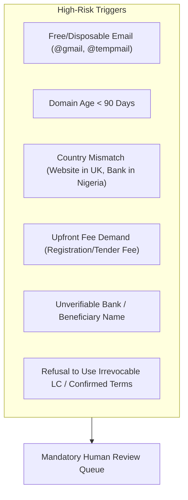

# 100-Point Buyer Verification & Risk Scoring Engine

## Core Philosophy
1. **Never fabricate missing data.** If a phone number or email is not publicly found with supporting evidence, it remains empty (`null`).
2. **Never mark a lead as verified without evidence.** Every verification check must log evidence (HTTP code, MX host, registry link, timestamp).
3. **Separate Qualification from Risk.** A company may sell high volumes of your product (95% qualification) but demand high-risk payment terms (Unsecured Open Account with high fraud indicators). Both scores must be presented side-by-side.

---

## 100-Point Verification Model

| Criterion Category | Weight | Sub-Checks & Evidence Breakdown |
| :--- | :---: | :--- |
| **1. Company Identity & Registration** | **20 pts** | - Active status in official registry (e.g. Companies House, MCA, VIES): **+10 pts** - Legal registered address matches official records: **+5 pts** - Incorporator / Director names identified in public registry: **+5 pts** |
| **2. Product & Industry Relevance** | **20 pts** | - Company explicitly sells, distributes, or imports relevant HS codes: **+10 pts** - Business model matches target buyer persona (Wholesaler, Distributor, Processor): **+6 pts** - Volume capacity matches exporter's Minimum Order Quantity (MOQ): **+4 pts** |
| **3. Website & Business Identity Consistency** | **15 pts** | - Domain resolves with valid HTTPS/TLS certificate: **+5 pts** - Domain registered $>1$ year ago (WHOIS check): **+4 pts** - Contact information on website matches directory/registry records: **+6 pts** |
| **4. Business Email Verification** | **15 pts** | - Domain is corporate-owned (not @gmail, @yahoo, @hotmail, or disposable): **+5 pts** - Domain has valid MX records configured: **+5 pts** - SMTP mailbox ping succeeds without bounce: **+5 pts** |
| **5. Evidence of Import Activity** | **15 pts** | - Documented import records, bill of lading references, or official buyer-seller meets: **+10 pts** - Customs registration or trade license verification: **+5 pts** |
| **6. Independent Supporting Evidence** | **15 pts** | - Established LinkedIn corporate page with verified employees: **+5 pts** - Membership in national trade association or Chamber of Commerce: **+5 pts** - Independent trade directory cross-confirmation: **+5 pts** |
| **Total** | **100 pts** | **Qualification Tier: 80-100 High Priority, 60-79 Potential, <60 Unverified** |

---

## Risk Flag Detection System

The system evaluates each prospect for financial and commercial fraud flags. When any of these triggers occur, a **Risk Flag** is attached to the record and outreach is automatically blocked until reviewed by a human administrator:

### Risk Evaluation Rules:
1. **Free Email Trigger**: Any business inquiry originating from an unverified public domain (@gmail, @yahoo, etc.) loses 15 verification points and is flagged with `FLAG_FREE_EMAIL_DOMAIN`.
2. **Offshore Bank Mismatch**: If an inquiry requests shipment to Country A but payment from an unrelated third-party entity in Country B, it is flagged with `FLAG_THIRD_PARTY_PAYER`.
3. **Suspicious Upfront Tender Fees**: Any buyer requesting registration fees or notarization fees to bid on a supply contract is flagged with `FLAG_ADVANCE_FEE_SCAM` and quarantined immediately.
